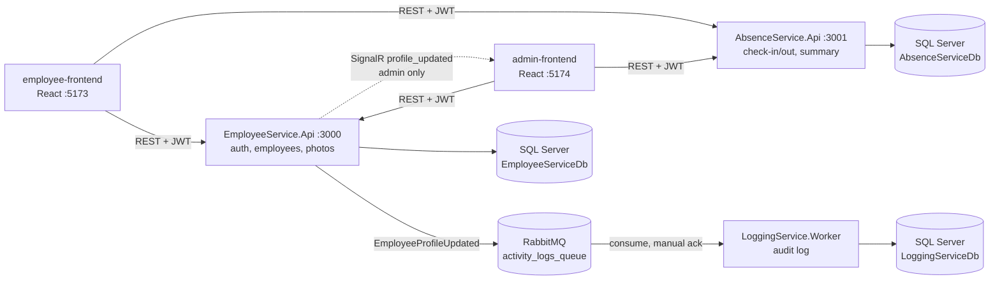

# Employee Absence Management System (.NET 8)

An HR attendance system built as **microservices with C#, ASP.NET Core 8 Web API, Entity Framework Core and SQL Server**.
Employees check in and out and manage their profile. HR admins manage employees, see everyone's attendance, and
get a real-time notification when an employee changes their profile.

This is a .NET port of my [NestJS version](https://github.com/RendySianipar/employee-absence-system). The API contract
is the same, so the original React frontends run against it with only one change (Socket.IO → SignalR).


## Architecture



Each service owns its database. The JWT is issued by Employee Service and validated by Absence Service with the
same secret, so the services never call each other synchronously.

| Project | Type | Responsibility |
| --- | --- | --- |
| `src/EmployeeService.Api` | ASP.NET Core Web API | Login (JWT + BCrypt), employee CRUD (admin), own profile, photo upload, SignalR hub, publishes events |
| `src/AbsenceService.Api` | ASP.NET Core Web API | Check-in / check-out, daily summary with date range, admin attendance view |
| `src/LoggingService.Worker` | .NET Worker Service | Consumes RabbitMQ events and stores an audit log |
| `src/EmployeeAbsence.Shared` | Class library | JWT validation, role constants, ProblemDetails error handling, RabbitMQ publisher, event contracts |
| `tests/*` | xUnit | Unit tests with Moq, integration tests with `WebApplicationFactory` |
| `frontend/*` | React + Vite | Employee app and HR admin app |

## Tech stack

C# 12 · .NET 8 · ASP.NET Core Web API · Entity Framework Core 8 (code-first migrations) · SQL Server 2022 ·
RabbitMQ · SignalR · JWT bearer auth · BCrypt · Swagger/OpenAPI · xUnit · Moq · Docker / Docker Compose ·
GitHub Actions · Azure DevOps Pipelines · React

## Design decisions

- **Layered services**: Controller → Service (business rules) → Repository (EF Core). Services depend on
  interfaces, so business rules are unit tested with Moq without a database.
- **Business rules for attendance**: one check-in and one check-out per employee per day; check-out requires a
  check-in. The rule is enforced in code (clear `409` message) and by a unique index (safe under concurrent requests).
- **Server-side time**: the employee id comes from the JWT and the date/time from the server clock in the
  configured time zone (`Asia/Jakarta`), so users cannot record attendance for someone else or backdate it.
  `TimeProvider` is injected so tests control the clock.
- **SQL Server indexing**: the primary key (random GUID) is `NONCLUSTERED`; the table is clustered on
  `(EmployeeId, Date, Status)`. The summary query
  `WHERE EmployeeId = @id AND Date BETWEEN @start AND @end` becomes a single **Clustered Index Seek**
  (verified with the execution plan on 20,000 rows), and random GUID inserts do not fragment the table.
- **Security**: role-based authorization (`employee` / `admin`), the password hash is never returned by the API,
  passwords are masked (`********`) in events, logs and notifications, login returns the same message for unknown
  email and wrong password, the SignalR hub only accepts admin tokens, and photo uploads are limited to images ≤ 2 MB.
- **Reliable messaging**: durable queue, persistent messages, manual ack. Malformed messages are discarded;
  transient failures (e.g. database down) are requeued once. A RabbitMQ outage does not fail the user's profile update.
- **Consistent errors**: business exceptions map to RFC 7807 `ProblemDetails` (`400`, `401`, `403`, `404`, `409`)
  through one `IExceptionHandler`.
- **Operations**: `/health` endpoints (including the database), automatic migrations with retry on start-up,
  multi-stage Dockerfiles running as a non-root user.

## API

| Method | Route | Access | Description |
| --- | --- | --- | --- |
| POST | `/auth/login` | public | Returns `{ accessToken, employee }` |
| GET / PUT | `/employees/me` | employee | Own profile / update phone or password |
| POST | `/employees/me/photo` | employee | Upload profile photo (multipart `file`) |
| GET / POST | `/employees` | admin | List / create employees |
| GET / PUT / DELETE | `/employees/{id}` | admin | Read / update / delete an employee |
| POST | `/absences` | employee | `{ "status": "masuk" \| "pulang" }` |
| GET | `/absences/summary?startDate=&endDate=` | employee | Own attendance per day (default: this month) |
| GET | `/absences/admin?startDate=&endDate=` | admin | All attendance records |
| GET | `/absences/{id}` | owner or admin | One record |
| WS | `/hubs/notifications` | admin | SignalR event `profile_updated` |

Swagger UI: `http://localhost:3000/swagger` and `http://localhost:3001/swagger` (Development).

## Run it

### Option 1: Docker Compose (backend)

```bash
cp .env.example .env
docker compose up --build
```

This starts SQL Server, RabbitMQ (UI on `http://localhost:15672`, guest/guest) and the three services.
Databases are created by EF Core migrations, and an admin account is seeded from `.env`
(default `admin@company.com` / `Admin@12345`).

### Option 2: run the services locally

Requires the .NET 8 SDK. Start only the infrastructure in Docker, then run each service:

```bash
docker compose up -d sqlserver rabbitmq
dotnet run --project src/EmployeeService.Api --launch-profile http
dotnet run --project src/AbsenceService.Api --launch-profile http
dotnet run --project src/LoggingService.Worker
```

### Frontends

```bash
cd frontend/employee-frontend && npm install && npm run dev   # http://localhost:5173
cd frontend/admin-frontend && npm install && npm run dev      # http://localhost:5174
```

## Tests

```bash
dotnet test
```

47 tests:

- **Unit tests (xUnit + Moq)**: login rules, password hashing and masking, duplicate email, event publishing and
  broker failure, attendance rules (double check-in, check-out without check-in, time zone day boundary),
  summary grouping and default date range, message handler (valid, malformed and failed messages).
- **Integration tests (`WebApplicationFactory` + EF Core InMemory)**: real HTTP pipeline with JWT auth:
  `401` without a token, `403` for the wrong role, validation `400`, `409` conflicts, the password hash is not
  exposed, the employee id is taken from the token rather than the request body, tokens signed with another
  secret are rejected.

CI runs build (warnings as errors) and tests on every push and pull request: GitHub Actions
(`.github/workflows/ci.yml`) and Azure DevOps (`azure-pipelines.yml`).

## Changes compared with the NestJS version

| Area | NestJS version | .NET version |
| --- | --- | --- |
| Database | PostgreSQL, `synchronize: true` | SQL Server, EF Core migrations |
| Check-in | client sends `employeeId`, date and time | taken from JWT and server clock |
| Duplicate check-in | allowed | rejected (`409`) + unique index |
| `GET /employees/me` | returned the password hash | password hash never returned |
| Profile event | contained the new password hash | password masked |
| Real-time | Socket.IO, no auth | SignalR, admin JWT required |
| `GET /absences/{id}` | any user could read any record | owner or admin only |
| Errors | default Nest errors | `ProblemDetails` with consistent status codes |
| Tests | Nest scaffold specs | 47 unit and integration tests |
